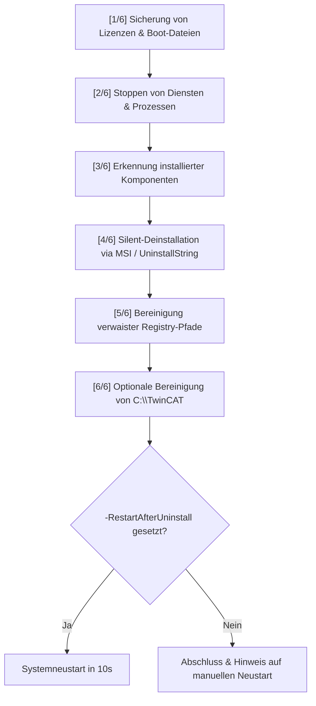

# TwinCAT 3.1 (Build 4024) – Automatisiertes Deinstallations-Skript

Dieses PowerShell-Skript (`Uninstall-TwinCAT4024.ps1`) dient der vollständigen, automatisierten und sauberen Deinstallation von **Beckhoff TwinCAT 3.1 Build 4024.xx** und sämtlichen zugehörigen Add-ons, Treibern und Komponenten (z. B. zur Vorbereitung auf ein Upgrade auf TwinCAT 4026 oder zur Fehlerbereinigung).

---

## 🚀 Funktionsumfang

1. **Automatische Sicherung (Backup):**
   - Sichert bestehende TwinCAT-Lizenzen (`Target\License` und `CustomConfig\Licenses`).
   - Sichert vorhandene SPS-Boot-Projekte (`3.1\Boot`).
2. **Beenden von Prozessen & Diensten:**
   - Stoppt TwinCAT-Dienste (u. a. `TcSysSrv`, `TcAdsSysSrv`, `TcEventLogger`, `TcTimerSrv`, `TcRealtimeDriver`).
   - Beendet laufende TwinCAT-Tools und Instanzen (`TcSysUI`, `TcXaeShell`, `devenv`, `TcRouter` etc.).
3. **Automatisierte Deinstallation (Silent):**
   - Erkennt installierte Beckhoff-/TwinCAT-Produkte in den 32-Bit- und 64-Bit-Registry-Pfaden.
   - Deinstalliert in optimaler Reihenfolge: zuerst Erweiterungen/Module (Scope, Target Browser, Extensions), anschließend TwinCAT Core / XAE / XAR.
   - Führt Deinstallationen geräuschlos (`/qn`, `/norestart`) via `msiexec` oder Silent-Uninstaller aus.
   - Protokolliert MSI-Deinstallationen unter `%TEMP%\uninstall_<GUID>.log`.
4. **Registry-Bereinigung:**
   - Entfernt verbleibende TwinCAT 3-Schlüssel aus `HKLM` und `HKCU`.
5. **Ordnerbereinigung (Optional):**
   - Entfernt auf Wunsch das Hauptverzeichnis `C:\TwinCAT`.
6. **Neustart-Option:**
   - Optionaler automatischer Neustart zur vollständigen Entladung gesperrter Kernel-Treiber (`.sys`).

---

## 📋 Voraussetzungen

- **Betriebssystem:** Windows 10 / 11 / Windows Server
- **PowerShell:** Windows PowerShell 5.1 oder PowerShell 7+
- **Berechtigungen:** PowerShell-Sitzung muss mit **Administratorrechten** gestartet werden ("Als Administrator ausführen").

---

## ⚙️ Parameter

| Parameter | Typ | Standardwert | Beschreibung |
| :--- | :--- | :--- | :--- |
| `-BackupPath` | `string` | `C:\TwinCAT_Backup_<Zeitstempel>` | Zielverzeichnis für die Sicherung der Lizenzen und Boot-Projekte. |
| `-SkipBackup` | `switch` | `$false` | Überspringt die Sicherung von Lizenzen und Boot-Dateien komplett. |
| `-RemoveFolder` | `switch` | `$false` | Löscht nach der Deinstallation den verbleibenden Ordner `C:\TwinCAT`. |
| `-RestartAfterUninstall` | `switch` | `$false` | Führt nach Abschluss automatisch einen Systemneustart durch (10 Sekunden Countdown). |

---

## 💻 Anwendungsbeispiele

> [!IMPORTANT]
> Öffnen Sie die PowerShell immer mit **Administratorrechten** (Rechtsklick auf PowerShell $\rightarrow$ *Als Administrator ausführen*).

### 1. Standard-Deinstallation (mit automatischem Backup, Ordner bleibt erhalten)
Sichert Lizenzen & Boot-Dateien nach `C:\TwinCAT_Backup_<Zeitstempel>` und deinstalliert alle Komponenten. Der Ordner `C:\TwinCAT` bleibt für eventuelle Restdateien bestehen:
```powershell
.\Uninstall-TwinCAT4024.ps1
```

### 2. Vollständige Deinstallation inklusive Ordnerbereinigung
Deinstalliert alle Komponenten, sichert Lizenzen und löscht danach `C:\TwinCAT`:
```powershell
.\Uninstall-TwinCAT4024.ps1 -RemoveFolder
```

### 3. Deinstallation mit benutzerdefiniertem Backup-Pfad und automatischem Reboot
Empfohlene Variante vor einem Versionswechsel (z. B. auf Build 4026):
```powershell
.\Uninstall-TwinCAT4024.ps1 -RemoveFolder -BackupPath "D:\Backups\TwinCAT_Alt" -RestartAfterUninstall
```

### 4. Schnelldurchlauf ohne Sicherung
Nur verwenden, wenn keine Lizenzen oder Boot-Projekte auf dem System verbleiben müssen:
```powershell
.\Uninstall-TwinCAT4024.ps1 -SkipBackup -RemoveFolder
```

---

## 🔍 Ablaufphasen im Detail



1. **`[1/6]` Sicherung:** Kopiert gefundene Lizenzdateien (`*.tcl` / `*.tcr`) und Boot-Ordner in `$BackupPath\Licenses` bzw. `$BackupPath\Boot`.
2. **`[2/6]` Dienste & Prozesse:** Verhindert Dateisperren während der Deinstallation durch gezieltes Beenden.
3. **`[3/6]` Inventarisierung:** Listet alle Beckhoff-Pakete aus den Windows-Uninstall-Zweigen auf.
4. **`[4/6]` Deinstallation:** Ruft für jedes gefundene Paket den entsprechenden Silent-Uninstaller auf.
5. **`[5/6]` Registry:** Löscht `HKLM:\SOFTWARE\Beckhoff\TwinCAT3`, WOW6432Node sowie `HKCU`.
6. **`[6/6]` Bereinigung:** Entfernt bei gesetztem `-RemoveFolder` das Verzeichnis `C:\TwinCAT`.

---

## ⚠️ Wichtige Hinweise

- **Neustart erforderlich:**  
  TwinCAT installiert Echtzeit-Treiber auf Kernel-Ebene (`.sys`). Diese können im laufenden Betrieb nicht immer vollständig aus dem Arbeitsspeicher entladen werden. Ein Neustart nach Ausführung des Skripts wird daher dringend empfohlen, bevor eine Neuinstallation gestartet wird.
- **Log-Dateien:**  
  Sollte eine MSI-Deinstallation fehlschlagen, finden sich die detaillierten Deinstallations-Logs im temporären Ordner des Benutzers:  
  `%TEMP%\uninstall_{GUID}.log`
- **Ausführungsrichtlinie (ExecutionPolicy):**  
  Falls PowerShell die Skriptausführung blockiert, kann die Ausführung für die aktuelle Sitzung freigegeben werden:
  ```powershell
  Set-ExecutionPolicy -Scope Process -ExecutionPolicy Bypass
  ```
